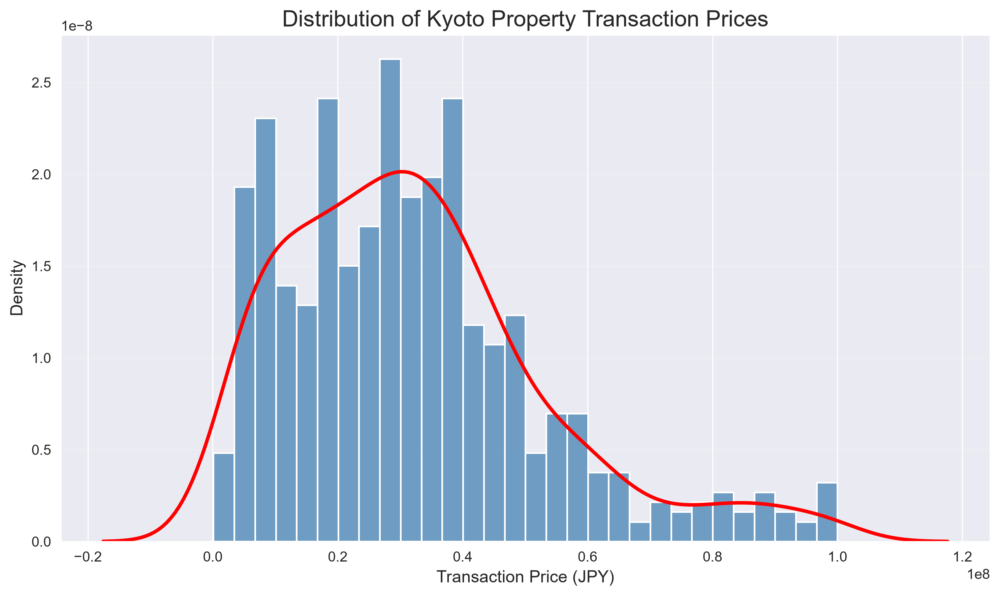
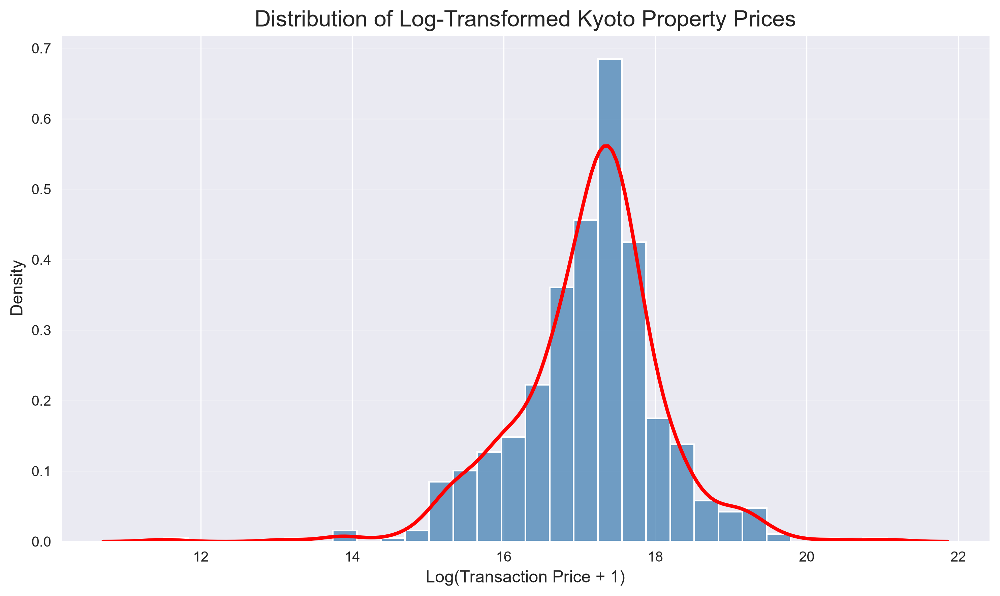
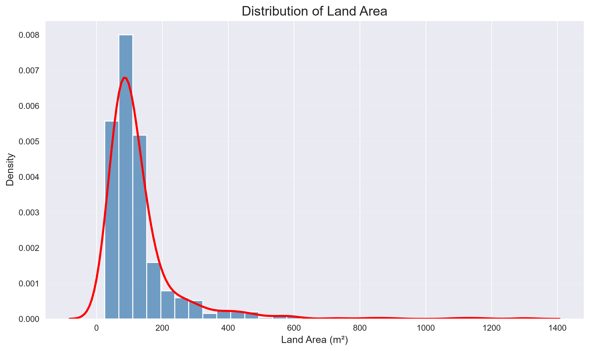

# Kyoto House Price Prediction

An end-to-end machine learning project for predicting residential property prices in Kyoto, Japan.

The project focuses on building a complete ML workflow from data preprocessing and exploratory data analysis to model training, evaluation, explainability, and API deployment.

## Project Overview

The goal of this project is to develop a machine learning system that can estimate the total transaction price of residential properties in Kyoto based on property characteristics such as:

- Land area
- Total floor area
- Year built
- Distance from the nearest station
- Road characteristics
- Building structure
- City planning information
- Transaction period

The project is designed as a practical AI/ML portfolio project demonstrating skills in data preprocessing, exploratory data analysis, machine learning, model evaluation, explainable AI, and API development.

### Machine Learning Workflow

```text
Raw Real Estate Data
        ↓
Data Cleaning & Preprocessing
        ↓
Feature Engineering
        ↓
Exploratory Data Analysis
        ↓
Model Training
        ↓
Model Comparison
        ↓
Model Evaluation
        ↓
Explainable AI (SHAP)
        ↓
FastAPI Prediction API
        ↓
Docker Deployment
```

## Dataset


The dataset is based on real-estate transaction information published by the Japanese Ministry of Land, Infrastructure, Transport and Tourism (MLIT) through the Real Estate Information Library.

For this project, the analysis focuses on residential land-and-building transactions in Kyoto City.

The original dataset contains Japanese column names and values. A preprocessing pipeline was created to convert the relevant information into an English-feature dataset for machine learning.

The raw and processed CSV datasets are not included in this GitHub repository.

## Target Variable

The target variable is:

`total_transaction_price`

It represents the total transaction price of the property in Japanese yen (JPY).

The target variable is strongly right-skewed because a small number of properties have much higher transaction prices than most properties.

A log transformation is therefore explored during the baseline modeling process.

## Features

The main features used in the project include:

| Feature | Description |
|---|---|
| `land_area_sqm` | Land area in square meters |
| `total_floor_area_sqm` | Total floor area in square meters |
| `year_built` | Year the property was built |
| `station_distance_minutes` | Distance from the nearest station in minutes |
| `frontage_m` | Property frontage in meters |
| `front_road_width_m` | Width of the road in front of the property |
| `building_coverage_ratio` | Building coverage ratio |
| `floor_area_ratio` | Floor-area ratio |
| `building_structure` | Structure of the building |
| `property_use` | Intended property use |
| `future_use` | Future intended use |
| `front_road_direction` | Direction of the front road |
| `front_road_type` | Type of the front road |
| `city_planning` | City planning / zoning category |
| `transaction_period` | Period when the transaction occurred |


## Data Preprocessing

The preprocessing pipeline performs the following steps:

1. Load the original MLIT dataset.
2. Filter land-and-building transactions.
3. Select relevant machine learning features.
4. Remove price-derived columns to prevent target leakage.
5. Convert numerical columns into appropriate numeric formats.
6. Convert Japanese-era building years into Western calendar years.
7. Translate Japanese categorical values into English.
8. Remove duplicate processed records.
9. Save the processed dataset as an English-feature CSV file.

### Target Leakage Prevention

The following price-derived columns are excluded from the model:

- `坪単価` — Price per tsubo
- `取引価格（㎡単価）` — Transaction price per square meter

These variables are derived from the transaction price and could cause target leakage if used as input features.

## Exploratory Data Analysis

The project includes exploratory analysis to understand the dataset and identify important patterns before model training.

The current EDA includes:

- Transaction price distribution
- Log-transformed price distribution
- Land area distribution
- Missing-value analysis
- Numerical feature statistics
- Categorical feature analysis
- Feature correlations
- Target-variable skewness
- Basic outlier analysis

### Price Distribution



### Log-Transformed Price Distribution



### Land Area Distribution



The transaction price distribution is strongly right-skewed. A log transformation is therefore explored to make the target distribution more suitable for regression modeling.

## Regression Animation

The project includes an animated visualization of the Linear Regression baseline.

The animation shows the relationship between land area and transaction price and provides a visual representation of the regression model.

The generated animation is stored at:

`backend/outputs/kyoto_linear_regression_animated.mp4`

## Planned Machine Learning Models

After establishing the Linear Regression baseline, the project will compare additional machine learning models:

- Linear Regression
- Random Forest
- XGBoost

The models will be evaluated using:

- Mean Absolute Error (MAE)
- Root Mean Squared Error (RMSE)
- R² Score

The goal is to compare model performance and identify the most suitable approach for Kyoto house price prediction.

## Explainable AI

SHAP (SHapley Additive exPlanations) will be used to interpret the machine learning models.

The goal is to understand how different property characteristics influence predicted prices.

The analysis will investigate questions such as:

- How important is land area?
- How important is total floor area?
- Does distance from the nearest station affect predicted price?
- Does building age influence predictions?
- Which features contribute most to high-value property predictions?

## Backend

The backend is being developed using:

- Python
- Pandas
- NumPy
- Scikit-learn
- FastAPI

Planned backend technologies include:

- SQLAlchemy
- PostgreSQL

## API

A FastAPI-based REST API will be developed to serve the trained machine learning model.

The API will accept property information such as:

- Land area
- Total floor area
- Year built
- Distance from the nearest station
- Other selected property features

The API will return the predicted property price in Japanese yen (JPY).

Example request:

```json
{
  "land_area_sqm": 120,
  "total_floor_area_sqm": 90,
  "year_built": 2005,
  "station_distance_minutes": 8
}
```
Example response:

    {
      "predicted_price": 31500000,
      "currency": "JPY"
    }

The API and model-serving functionality will be implemented as the project progresses.

## Frontend

A React-based frontend will be developed to provide a simple interface for the house price prediction system.

The frontend will allow users to:

- Enter property information
- Submit prediction requests
- View the predicted property price
- Display prediction results in a clear and user-friendly format

The frontend will communicate with the FastAPI backend through REST API endpoints.

The frontend is being developed separately from the backend so that both parts of the project can be developed independently.

## Deployment

The application will be containerized using Docker and Docker Compose.

The planned system architecture is:

React Frontend
        ↓
FastAPI Backend
        ↓
Machine Learning Model
        ↓
PostgreSQL Database

Docker will be used to provide a consistent development and deployment environment for the application.

## Project Structure

    kyoto-house-price-prediction/
    │
    ├── backend/
    │   ├── app/
    │   │   ├── ml/
    │   │   │   ├── preprocessing.py
    │   │   │   ├── eda.py
    │   │   │   └── animate_regression.py
    │   │   │
    │   │   ├── routers/
    │   │   ├── database.py
    │   │   ├── main.py
    │   │   ├── models.py
    │   │   └── schemas.py
    │   │
    │   ├── data/
    │   │   ├── raw/
    │   │   └── processed/
    │   │
    │   ├── notebooks/
    │   │   └── 01_eda.ipynb
    │   │
    │   ├── outputs/
    │   │   └── eda/
    │   │
    │   ├── tests/
    │   │   └── test_api.py
    │   │
    │   ├── Dockerfile
    │   └── requirements.txt
    │
    ├── frontend/
    │   ├── src/
    │   ├── package.json
    │   └── Dockerfile
    │
    ├── docker-compose.yml
    ├── .env.example
    ├── .gitignore
    └── README.md


## Current Project Status

### Completed

- [x] Project structure
- [x] Git and GitHub setup
- [x] Dataset preprocessing
- [x] Land-and-building property filtering
- [x] English feature transformation
- [x] Japanese-era year conversion
- [x] Target leakage prevention
- [x] Duplicate removal
- [x] Exploratory data analysis
- [x] Price distribution analysis
- [x] Log-price distribution analysis
- [x] Land-area distribution analysis
- [x] Linear Regression baseline experiment
- [x] Regression animation

### In Progress / Planned

- [ ] Feature engineering
- [ ] Missing-value handling for model training
- [ ] Categorical feature encoding
- [ ] Random Forest
- [ ] XGBoost
- [ ] Model comparison
- [ ] Hyperparameter tuning
- [ ] SHAP explainability
- [ ] Model persistence with Joblib
- [ ] FastAPI prediction endpoint
- [ ] PostgreSQL integration
- [ ] React frontend integration
- [ ] Docker deployment
- [ ] Automated API tests
- [ ] MLflow experiment tracking
- [ ] GitHub Actions CI/CD

## Future Improvements

Future versions of the project will focus on:

- Expanding the dataset to additional Kyoto wards
- Including more historical transaction periods
- Adding geographic and location-based features
- Improving feature engineering
- Comparing additional machine learning algorithms
- Hyperparameter optimization
- Model explainability with SHAP
- Production-ready API deployment
- Interactive React frontend
- PostgreSQL prediction history
- Dockerized deployment
- Automated testing and CI/CD
- MLflow experiment tracking


## Technologies

### Machine Learning

- Python
- NumPy
- Pandas
- Scikit-learn
- XGBoost
- SHAP

### Backend

- FastAPI
- SQLAlchemy
- PostgreSQL

### Frontend

- React
- Vite
- JavaScript

### Development & Deployment

- Git
- GitHub
- Docker
- Docker Compose
- PyTest
- MLflow
- GitHub Actions

## Data Source

The project uses real-estate transaction information published by the:

**Ministry of Land, Infrastructure, Transport and Tourism (MLIT), Japan**

Real Estate Information Library:

https://www.reinfolib.mlit.go.jp/

The dataset is used for educational and portfolio development purposes.

The raw and processed CSV datasets are excluded from this repository.

